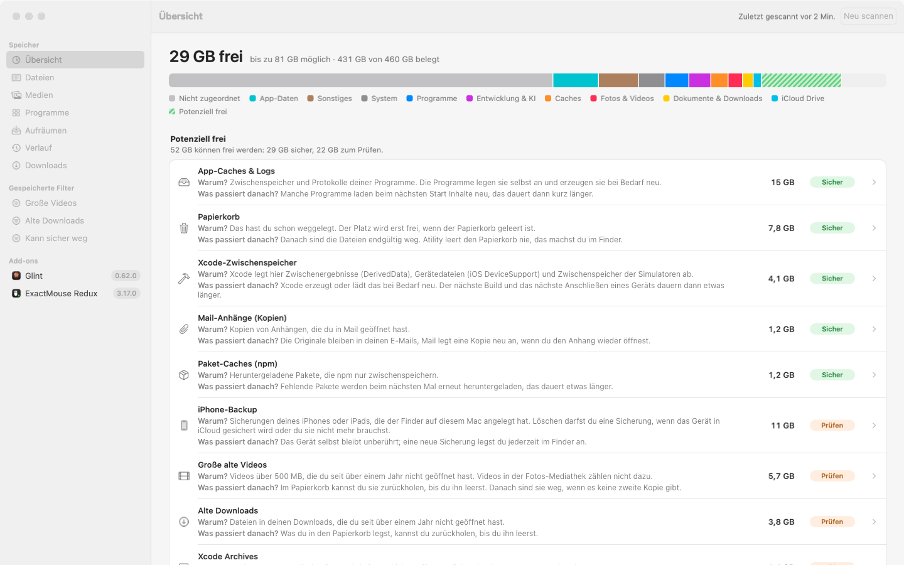
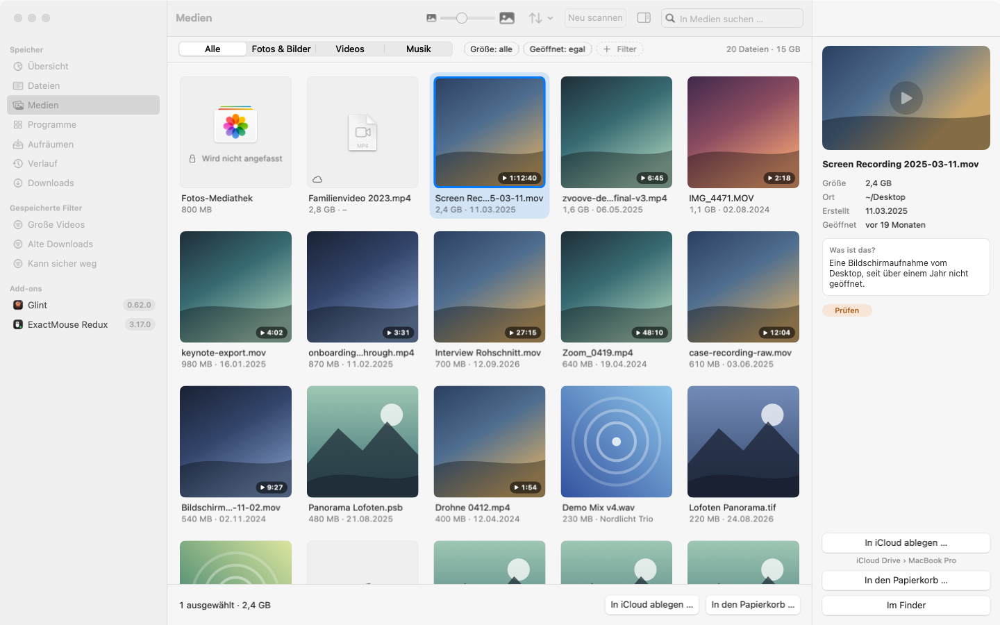
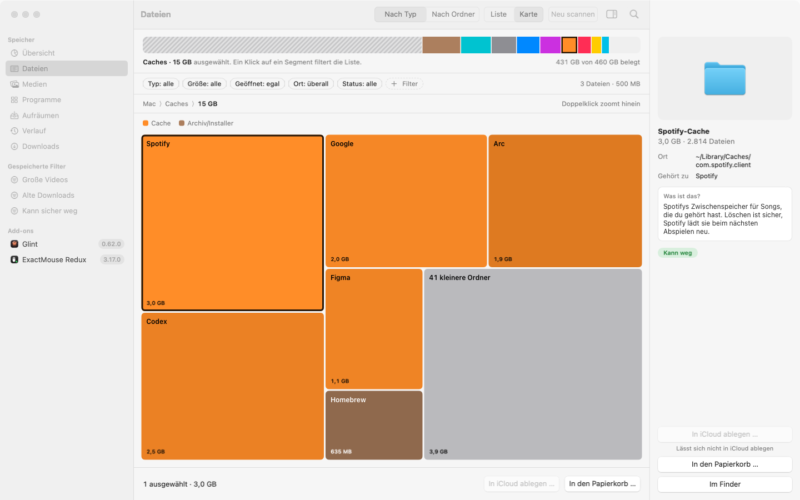
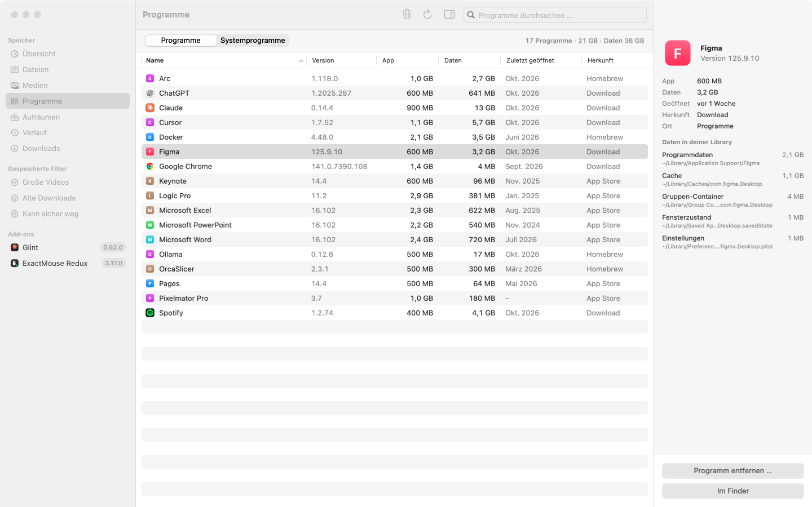
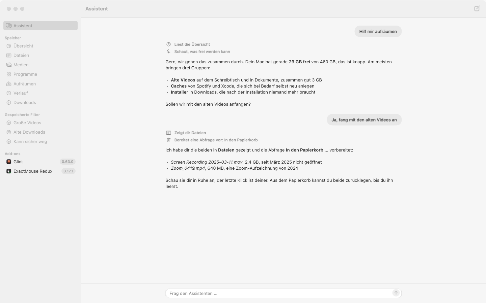
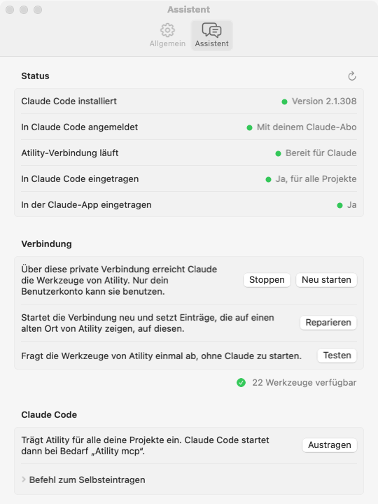

<h1 align="center">Atility</h1>

  <b>See what fills your Mac. Clean up without fear.</b> 
  A native macOS app that explains every big item on your disk, suggests what can go, 
  and never deletes anything you didn't confirm.

  <a href="https://github.com/iamadesignerusually/atility-releases/releases/latest"><b>Download the latest version</b></a>
  &nbsp;·&nbsp; macOS 14 or later &nbsp;·&nbsp; Apple Silicon and Intel

  

---

## Why Atility

macOS tells you that "System Data" takes 80 GB — and then leaves you alone with Finder. Atility scans your disk, groups everything into categories you understand, and tells you in one plain sentence what each item is, whether it is safe to remove and what happens afterwards.

## Safe by design

- **Nothing is deleted for good.** Atility only moves files to the Trash or into a tidy folder in iCloud Drive. You empty the Trash yourself.
- **Every round can be undone** from the History.
- **You always confirm.** Every action shows exactly which files are affected and how much space they take.
- **Protected stays protected.** Apps outside the uninstall flow, system files, Git repositories, work folders of tools like Claude, ChatGPT or Cursor, and your **Photos library** are never moved.

## What it does

| | |
|---|---|
| **Overview** | Used, free and *potentially free* space at a glance, plus hidden space hogs: iPhone backups, Xcode data, Mail attachments, Time Machine snapshots. |
| **Files** | A sortable list or a colorful treemap, filters by type, size and age, and an inspector that explains every item. |
| **Media** | All photos, videos and music as a grid with real previews. Press space for Quick Look, just like in Finder. |
| **Programs** | App sizes including their hidden data, and a safe way to remove apps you no longer use. |
| **Clean up** | Tidy your desktop into `iCloud Drive › <your Mac>` — screenshots by month, documents by year — with a preview before anything moves. |
| **History** | A log of every round: what went where, how big it was, and an undo button. |
| **Assistant** | Ask *"Help me clean up"* or *"What are these files?"*. Runs on your existing Claude subscription through Claude Code — no API key, no extra cost. It only sees names, sizes and dates, asks before looking into a file, and only prepares actions for you to confirm. |
| **Menu bar** | Free space, potential space and one-click desktop cleanup, always within reach. |

  
  

  

## Install

1. Download **`Atility.dmg`** from the [latest release](https://github.com/iamadesignerusually/atility-releases/releases/latest) and open it.
2. Drag **Atility** into **Applications**.
3. First launch on macOS 15 or later: open Atility once, then go to **System Settings › Privacy & Security** and click **Open Anyway**.
4. Grant **Full Disk Access** when Atility asks, so it can see everything that fills your disk.

Atility is not notarized by Apple yet, which is why macOS asks once.

## Assistant

Ask Atility in plain language — *"Help me clean up"*, *"Check my Trash"*, *"I'm afraid to delete this, is it okay?"*. The assistant reads your scan, asks before anything sensitive, shows you the files right in the app and prepares the confirmation. The last click is always yours.

  

## Use it from Claude

Atility is also an MCP server. Register it in **Settings › Assistant** with one click, then ask Claude Code or the Claude app about your Mac's storage. Suggestions still land in Atility for you to confirm.

  

## Privacy

Atility runs entirely on your Mac. It sends nothing anywhere — unless you use the assistant, which shares only file names, paths, sizes and dates with Claude, and file contents only after you allow it for specific files.

## License and EULA

Atility is proprietary software. See the [license notice](LICENSE) and the
[Atility EULA](EULA.md). **The EULA is a draft for legal review, not approved for
distribution.** It prepares terms for future releases, subject to legal review
and valid agreement. Publishing these documents does not establish acceptance
or change rights in earlier copies.

The intended model allows Atility Free without payment, including for commercial
work. Pro is intended to require a paid license once sales begin; no Free/Pro
feature split, purchase, activation, or paid license verification is implemented
by these documents. Earlier valid license grants, contractual and statutory
entitlements, and third-party notices remain unaffected, including rights in
reused material.

Future app builds include these documents for offline reading in **Atility ›
License & EULA…** and **Settings › General**. Existing release downloads remain
unchanged; this documentation update publishes no new app version. The reader
provides access to the texts and does not record agreement.

## Language

The app is currently in German. English is coming in version 1.2.

---

Made by Maximilian Dahl

